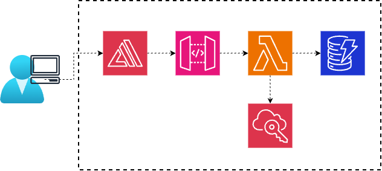

# aws-serverless-web-app
AWS serverless web application using Amplify, Lambda, API Gateway, DynamoDB and IAM

## Architecture Diagram

## Project Overview
This project demonstrates the deployment of a serverless web application using Amazon Web Services (AWS).
The application allows users to enter a base number and an exponent to perform a mathematical calculation.
The project was completed as a hands-on learning excercise

## AWS Services Used
| Column 1 | Column 2 | Column 3 |
| :--- | :---: | ---: |
| Left-aligned | Centered | Right-aligned |
| Row 2 | Row 2 | Row 2 |
